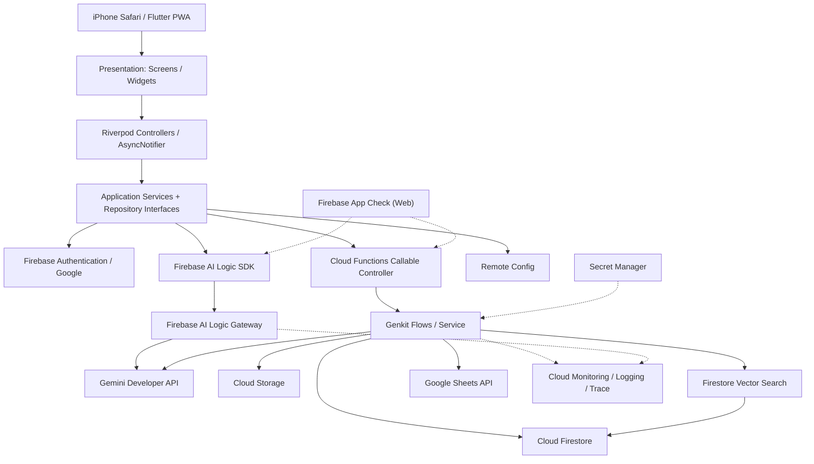
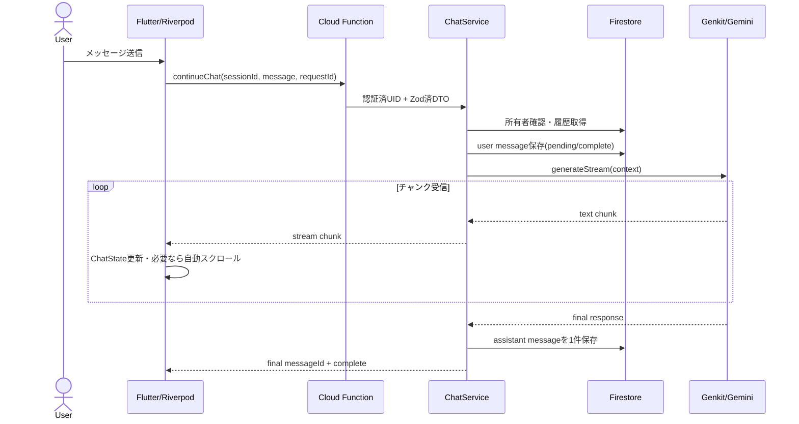
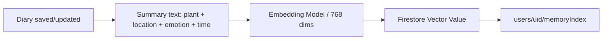

# 植物観察日記 — 技術設計書（DESIGN）

> Project: **Plant Memory Journal**（仮称）  
> Document: `design.md`  
> Version: 1.0.0 / 2026-10-25  
> Status: Implementation Ready（外部コンソールでの設定・SDK動作確認は未実施）  
> Target: **Claude Code** による段階的な実装  
> Primary platform: **iPhone Safari / Flutter Web PWA**（App Store審査なし）

---

## 0. Claude Codeへの最上位指示

本ドキュメントを唯一の初期設計基準として、**小さな実装単位でテストを通しながら**開発する。仕様と実装が不一致になったときは黙って変更せず、設計上の差分を `docs/decisions/` にADRとして残す。

### 絶対ルール

1. **Flutter Web PWAを最優先**。ネイティブiOSビルドやApp Store申請はMVPに含めない。Xcode導入済みでも、Web PWAのApp Check方式を使用する。
2. Flutterは **Presentation → Application（Riverpod）→ Domain → Data**、TypeScriptは **Controller → Service → Repository → Domain** を分離する。UIからFirestoreやCloud Functionsを直呼びしない。
3. **SOLID / 単一責任 / 依存性逆転**を守り、Repositoryはインターフェース経由で注入する。小さな関数、早期return、明示的エラーを優先。
4. TypeScript APIの入力と出力を **Zodで定義し、`schemas/`に分離**する。`any`とノーチェックのJSONキャストは禁止。
5. **Firebase Authenticationによる本人確認 + App Check + `uid`に基づく所有者認可**を必須とする。クライアントが送った`uid`は信用しない。
6. **Gemini API Key / OAuth Refresh Token / Secretはクライアントに埋め込まずSecret Manager等で管理**する。`.env`などの機密ファイルをGitに追加しない。
7. 生成AIは非決定的。モデルが返す植物名・感情判定は推測として表示し、利用者による修正を許容する。感情を医学的に診断しない。
8. **開発環境はFirebase Emulator Suiteを基本**にし、AI・Google Sheets外部APIはモック可能なAdapterとする。本物のGeminiを呼ぶテストは明示的なopt-inのみ。
9. **実際のSDK APIを公式ドキュメントまたはインストール済みの型定義で確認してから実装**する。疑似コードをそのまま動くコードとして扱わない。
10. 主要機能の完了条件は `flutter analyze` / `flutter test` / `npm run lint` / `npm run typecheck` / テスト合格、およびREADMEの手順更新。
11. ユーザーが行うFirebase/Google Cloudコンソール操作は**チェックリスト化し、人間による実行待ち**にする。資格情報や請求の設定を勝手に行わない。
12. **Phase 1のMVP完成を優先**。RAG、Google Sheets、Google検索、A2Aは拡張ポイントを設計したうえで段階導入する。

### 推奨ワークフロー

```text
Read design.md
  → docs/implementation-plan.md 作成（小タスク・依存関係）
  → firebase / flutter 初期化
  → domain + schemas + mock repositories
  → サービス単位で実装・単体テスト
  → エミュレータ統合テスト
  → iPhone Safari / ホーム画面PWA実機テスト
  → セキュリティ検証
  → フェーズごとのDone判定
```

---

## 1. プロダクトの背景とゴール

### 1.1 コンセプト

**植物・山・自然を撮影し、その場所での気持ちをAIと対話しながら記録する植物観察日記。** 日記・画像・位置・対話履歴をもとに、過去の似た自然体験を提示する「思い出アシスタント」を提供する。

### 1.2 ユーザーストーリー

- US-01: Googleアカウントで安全にログインし、自分だけの日記を持ちたい。
- US-02: iPhoneで植物や山の写真を撮り、植物の名前をAIに推測してほしい。
- US-03: 撮影日時とGPSを記録し、必要なら位置精度を下げる・記録しないを選びたい。
- US-04: 「楽しい」「不安」「落ち着いた」など自由文で気持ちを入力し、AIから思いやりのあるコメントがほしい。
- US-05: AIとのやりとりをそのまま複数ターン続け、後日読み返したい。
- US-06: 「以前この花を見て元気になったのはいつ？」を、似た日記から提案してほしい。
- US-07: 必要に応じて、その年の日記をGoogle Sheetsへ月別に転記したい。
- US-08: App Storeを使わず、Safariからホーム画面に追加して使いたい。
- US-09: 自分の写真・位置・感情を削除したい。

### 1.3 非ゴール（初期）

- SNS・他ユーザーとの公開共有、コミュニティ機能
- 植物の学術的な厳密同定や病気診断
- メンタルヘルスの治療、医療行為、危機対応の代行
- 完全オフライン推論・完全オフライン同期
- Google Calendarイベント自動作成（Sheetsとは別途検討）
- 複数のLLM Agentによる自律的な外部書き込み
- A2Aを用いた分散エージェント実行（将来対応）

### 1.4 MVPの完成条件（End-to-End）

1. iPhone Safariで起動し、Googleログインできる。
2. 撮影または画像選択、GPSの許可/拒否ができる。
3. 画像から植物候補を取得し、候補が不確かなら「特定できない」と表示する。
4. 気持ちを入力すると初回AIフィードバックが表示され、日記に保存される。
5. 日記一覧・詳細で写真、日付、位置、感情、AI応答を確認できる。
6. セキュリティルールにより、別ユーザーのデータは取得/変更できない。
7. Emulator Suite + モックAIで自動テストが動く。
8. PWAとしてホーム画面から起動可能で、基本操作をiPhone Safariで確認済み。

---

## 2. 前提条件、契約、課金

### 2.1 契約前提

- 開発者は **Google AI Pro** を契約している前提。
- **Google AI ProとGemini Developer APIの課金は別**。AI Pro契約がアプリのAPIリクエストを無制限に無料化するものではない。
- Cloud Functions、Firestore、Cloud Storage、Firebase Hosting、Monitoring、Google Sheets APIなどは、それぞれの無料枠・課金・クォータに従う。
- Gemini Developer APIを利用する。`AI Logic`のクライアント経路と、`Genkit`のサーバー経路で**同じ課金プロジェクト・利用量を監視**する。
- Cloud Functionsデプロイや一部Firebase/Google Cloud機能のため、Blazeプランが必要になる可能性が高い。**人間が支出上限・予算アラート・請求設定を確認した後**に本番デプロイする。
- Google AI Studio APIキーの発行、OAuth同意画面、Google Sheets API有効化、必要な権限と課金設定は**人間が実施する**。

### 2.2 利用モデル（初期値・変更可能）

| 目的 | 初期候補 | 注記 |
|---|---|---|
| 写真理解・植物候補 | `gemini-3.8-flash` | マルチモーダル画像理解 |
| 初回感情フィードバック | `gemini-3.8-flash` | 応答品質優先 |
| 短文の補助処理 | `gemini-3.5-flash-lite` | コスト/レイテンシ低減候補 |
| マルチターン | `gemini-3.8-flash` | 履歴の長さを制限 |
| Embedding | `gemini-embedding-2` / 768次元 | Firestore最大次元を超えない。SDK対応は実装時確認 |

- モデルの世代交代に備えてRemote Configまたはサーバー設定で切替可能にする。
- 同じ日記に対する同内容の推論はキャッシュし、むやみに再実行しない。
- **画像生成用モデルは使用しない**（写真の認識が目的）。
- `gemini-2.0-flash` 等の提供終了モデルを新規実装に使用しない。

### 2.3 初期コスト抑制

- ユーザーごとに一定時間内の最大推論回数を制限（値はConfigに定義）。
- 画像サイズをクライアント側で縮小・圧縮し、元画像と推論用サムネイルを分離。
- チャット履歴は直近N件と要約に制限。初期値は直近20件程度の**設定値**。
- RAGは最初Top-K=5とし、検索候補をむやみに増やさない。
- 同一`diaryId`のembedding再計算を避ける（`contentHash`, `embeddingModelVersion`を保存）。
- 開発環境はエミュレータ+Fake AIをデフォルトとする。
- Cloud Loggingに写真そのもの、GPSの生値、感情の原文、会話全体を不用意に記録しない。

---

## 3. 技術スタック

| レイヤー | 技術 |
|---|---|
| Web/PWA | Flutter Web、Firebase Hosting、Web App Manifest |
| 状態管理 | `flutter_riverpod`、`AsyncNotifier`、`AsyncValue` |
| ナビゲーション | `go_router`（最少画面） |
| 認証 | `firebase_auth` / Google Provider |
| 撮影/画像選択 | `image_picker`（Web動作確認）、必要に応じWeb専用Adapter |
| GPS | `geolocator` + permission/error handling |
| クライアントAI | `firebase_ai`（Firebase AI Logic SDK） |
| API | `cloud_functions` / Firebase Callable Functions |
| サーバー | TypeScript / Node.js（Cloud Functions対応版を採用） |
| AIワークフロー | Genkit `ai.defineFlow`、Dotprompt、Google GenAI Plugin |
| 生成モデル | Gemini Developer API / Gemini Flash系 |
| バリデーション | Zod（サーバー）、Dartの型・モデル検証 |
| DB | Cloud Firestore |
| 写真 | Cloud Storage for Firebase |
| RAG | Gemini Embeddings + Firestore Vector Search + Genkit Retriever |
| 設定 | Firebase Remote Config（クライアント）+ サーバー設定 |
| シークレット | Google Cloud Secret Manager |
| App Check | **Flutter Web: reCAPTCHA Enterprise**（互換性は実装時確認） |
| 監視 | Firebase AI Monitoring + Genkit Telemetry + Cloud Logging/Trace/Monitoring |
| 外部出力 | Google Sheets API / OAuth 2.0 |
| テスト | `flutter_test`, `integration_test`, Vitest/Jest, Firebase Emulator Suite |
| 開発支援 | Claude Code / CLAUDE.md / ADR / GitHub Actions |

依存バージョンを固定し、`pubspec.lock`、`package-lock.json`をcommitする。新しいGenkitではGoogle用プラグインとして `@genkit-ai/google-genai` を優先し、既存サンプルの `@genkit-ai/googleai` を無条件に混在させない。

---

## 4. 全体アーキテクチャ



### 4.1 AI呼び出し経路の役割分担

**Path A: Flutter → Firebase AI Logic → Gemini**

- 写真の植物候補を**一時的に表示する用途**、保存前の単発画像解析などに利用可能。
- Firebase AI LogicクライアントSDKで `FirebaseAI.googleAI()`をProvider管理する。
- `generateContentStream`と`await for`でUIへチャンク表示可能。
- **クライアントからの推論結果を信頼済みの確定値としてDBに保存しない**。ユーザー確認後に日記保存APIへ渡し、サーバーがスキーマと所有者を検証する。
- Firebase AI LogicはEmbedding/Vector Searchを実行しない。

**Path B: Flutter → Cloud Functions → Genkit → Gemini + Firestore**

- **本アプリの正系（canonical）AI実行経路**：感情フィードバック、マルチターン、記憶RAG、永続化、Sheets連携。
- 呼出しはCallable（Auth / App Check確認）を基本とする。セッション履歴・プロンプト・AIコストをサーバーで統制。
- Genkitでプロンプト前処理、Retriever、ツール、生成、出力検証、永続化を構成。
- ストリーミングフローは`onCallGenkit`と`sendChunk`等の**現在のSDK実装**を確認して採用。クライアントAPIが対応しない場合は**非ストリーミングCallableを代替**し、未検証の独自エンドポイントを作らない。

**原則:** 同じチャットセッションをPath AとPath Bの双方から更新しない。`chatSession`の保存・履歴の正本はPath Bに限定する。

### 4.2 3層 + Domainの責任分担

| 責務 | Flutter | Functions / TypeScript |
|---|---|---|
| UI | Screen / Widget | — |
| 制御 | Riverpod `AsyncNotifier` | Callable Controller |
| アプリ処理 | Use Case（入力準備、UI遷移） | Service（ドメイン処理・オーケストレーション） |
| 永続化 | Data Source/Remote Repository Adapter | Firestore/Storage/Sheets Repository |
| ドメイン | 型・値オブジェクト・状態 | Entity・業務ルール・Schema |

依存の方向は外側から内側。Domain層はFirebase/Genkit/Flutterへの依存を持たない。

---

## 5. UI / 画面遷移

### 5.1 画面（初期4画面）

1. `/login`：Googleログイン、個人情報・位置許可の説明。
2. `/diaries`：日記一覧と日記作成・詳細（同一ページまたはモーダル）。写真・植物候補・感情・GPS・AIフィードバック。
3. `/diaries/:diaryId/chat`：初回フィードバックから会話を継続。ストリーミングと自動スクロール、終了・再開。
4. `/memories`：自然言語で過去の日記検索（Phase 3）。思い出カード、元の日記への遷移。

### 5.2 主要UX

- **撮影→感情入力→AIからの反応→保存**を最短導線にする。
- 写真なしの日記も可。山の写真から植物が識別できない場合は観察記録として保存可能。
- GPS許可を拒否しても記録できる。地図への紐付けは任意。
- 植物候補は候補名・確信度の説明（数値を保証しない）・「不明」を提示し、利用者が修正可能。
- AI返答は`AsyncValue`により **loading / data / error**を表示。レイテンシが長い場合は中断・再試行を表示。
- チャットは末尾追従しつつ、過去ログを手動で見ている最中は強制スクロールしない。
- PWA表示用manifest / icons / theme colorを用意。iOS Safariホーム画面追加と再起動を検証。
- 位置情報と感情情報について、利用前に明確な説明と削除導線を設ける。

### 5.3 Riverpod構成

```dart
// インターフェース構成の例。SDKのバージョンに合わせて実装する。
final authRepositoryProvider = Provider<AuthRepository>((ref) {
  return FirebaseAuthRepository(FirebaseAuth.instance);
});

final diaryRepositoryProvider = Provider<DiaryRepository>((ref) {
  return FirestoreDiaryRepository(FirebaseFirestore.instance);
});

final firebaseAiProvider = Provider<FirebaseAI>((ref) {
  return FirebaseAI.googleAI();
});

// Riverpodのコード生成を利用する場合はbuild_runnerも導入する。
// AsyncNotifierで非同期の画面状態と処理を一元管理する。
```

`ChatMessage`はメッセージ単位、`ChatState`はセッション全体の状態。`AsyncValue<ChatState>`はネットワーク中の読み込み・失敗を表し、チャンク受信中の表示は`ChatState.streamingText`等に保持する。

---

## 6. ドメインモデル

### 6.1 主要Entity

```typescript
type EmotionLabel =
  | 'joy' | 'calm' | 'sadness' | 'anxiety' | 'anger'
  | 'surprise' | 'neutral' | 'mixed' | 'unknown';

type PlantCandidate = {
  commonName: string;
  scientificName?: string;
  reason?: string;
};

type GeoPointValue = {
  latitude: number;
  longitude: number;
  precision: 'exact' | 'approximate';
  placeName?: string;
};

type Diary = {
  id: string;
  ownerUid: string;
  observedAt: string;            // ISO8601
  photoPaths: string[];          // Cloud Storageのpath。公開URLではない
  imageAnalysis?: {
    candidates: PlantCandidate[];
    modelName: string;
    reviewedByUser: boolean;
  };
  confirmedPlantName?: string;
  location?: GeoPointValue;
  emotion: {
    userText: string;
    userLabel?: EmotionLabel;
    aiSuggestedLabel?: EmotionLabel;
  };
  initialFeedback?: string;
  chatSessionId?: string;
  createdAt: string;
  updatedAt: string;
};

type ChatMessage = {
  id: string;
  sessionId: string;
  role: 'user' | 'assistant' | 'system';
  content: string;
  status: 'pending' | 'complete' | 'failed';
  createdAt: string;
  modelName?: string;
  promptVersion?: string;
};

type ChatSession = {
  id: string;
  ownerUid: string;
  diaryId: string;
  status: 'active' | 'completed' | 'interrupted';
  createdAt: string;
  completedAt?: string;
  summary?: string;
  messageCount: number;
};
```

- `createdAt`/`updatedAt`は**サーバータイムスタンプ**を正本とする。上記ISO文字列表現はAPI DTO例。
- 感情ラベルは利用者入力とAI推定を分ける。利用者の感情認識をAIが上書きしない。
- Chatの`system`メッセージはサーバー内部に限定し、Firestoreのユーザー表示履歴には原則書き込まない。
- 確定植物名は利用者入力を優先。植物の同定は画像だけでは不可能な場合がある。

### 6.2 Firestore構造

```text
users/{uid}                               # プロフィール、設定
  displayName, createdAt, preferredLocale

users/{uid}/diaries/{diaryId}
  observedAt, photoPaths[], location, emotion, imageAnalysis,
  confirmedPlantName, initialFeedback, chatSessionId, ...

users/{uid}/chatSessions/{sessionId}
  diaryId, status, summary, messageCount, createdAt, completedAt

users/{uid}/chatSessions/{sessionId}/messages/{messageId}
  role, content, status, modelName, promptVersion, createdAt

users/{uid}/memoryIndex/{memoryId}
  diaryId, summary, embedding(Vector 768), embeddingModel,
  embeddingVersion, contentHash, tags[], observedAt, ...

users/{uid}/integrations/googleSheets
  enabled, spreadsheetId, lastSyncedAt, syncStatus

users/{uid}/syncJobs/{jobId}
  target, diaryId, idempotencyKey, status, retryCount, ...
```

Firestoreで全文チャットを単一ドキュメントの配列に格納しない。1メッセージ1ドキュメントとし、セッションドキュメントにステータス・要約を保持する。

### 6.3 Storage構造

```text
user-uploads/{uid}/diaries/{diaryId}/original/{imageId}.jpg
user-uploads/{uid}/diaries/{diaryId}/preview/{imageId}.jpg
```

- 写真の型・容量・枚数を検証。原本のEXIF位置情報は仕様に従って除去または明示許可。
- 植物の公開写真集として第三者配信はしない。短命なダウンロードURLのみ使用する。
- `uid`単位のStorage Rulesを設定。
- 削除時はFirestore、Storage、Vector Index、Sheets連携情報の扱いを明示する。

---

## 7. API / Controller / Service / Repository

### 7.1 Callable API契約

| API/Flow | 入力 | 出力 | 初期フェーズ |
|---|---|---|---|
| `analyzePlant` | `diaryId`, `photoPath` | `candidates[]`, `modelName`, `notes` | 1 |
| `createDiary` | `observedAt`, `photoPaths[]`, `emotion`, `location?`, `confirmedPlantName?`, `clientRequestId` | `diaryId` | 1 |
| `generateInitialFeedback` | `diaryId`, `clientRequestId` | `feedback`, `aiSuggestedEmotion` | 1 |
| `listDiaries` | `cursor?`, `limit` | `items[]`, `nextCursor?` | 1 |
| `getDiary` | `diaryId` | `diary` | 1 |
| `updateDiary` | `diaryId`, 許可フィールドのみ | `diary` | 1 |
| `deleteDiary` | `diaryId` | `jobId`, `status` | 1 |
| `continueChat` | `sessionId`, `message`, `clientRequestId` | `messageId`, `text`, チャンク | 2 |
| `completeChat` | `sessionId` | `status` | 2 |
| `retrieveMemories` | `query`, `filters?` | `memories[]`, `answer` | 3 |
| `connectGoogleSheets` | OAuth開始 / コールバック | `enabled`, `spreadsheetId` | 3 |
| `syncDiaryToSheets` | `diaryId`, `clientRequestId` | `status`, `syncJobId` | 3 |

**重要:** 各APIはFirebase AuthenticationのUIDを`request.auth.uid`等の認証済みコンテキストから取得。リクエスト本文に`ownerUid`を受け取らない。認証がない場合は拒否する。

### 7.2 Zodスキーマ例

```typescript
// functions/src/schemas/diary.schema.ts
import { z } from 'zod';

export const geoSchema = z.object({
  latitude: z.number().min(-90).max(90),
  longitude: z.number().min(-180).max(180),
  precision: z.enum(['exact', 'approximate']),
  placeName: z.string().max(200).optional(),
});

export const createDiaryInputSchema = z.object({
  observedAt: z.string().datetime(),
  photoPaths: z.array(z.string().min(1)).max(5),
  emotion: z.object({
    userText: z.string().trim().min(1).max(2000),
    userLabel: z.string().max(40).optional(),
  }),
  location: geoSchema.optional(),
  confirmedPlantName: z.string().max(200).optional(),
  clientRequestId: z.string().uuid(),
}).strict();

export type CreateDiaryInput = z.infer<typeof createDiaryInputSchema>;
```

- 写真パスが `user-uploads/{auth.uid}/...` 配下であることは、**Zod形式検証とは別にServiceで照合**する。
- `datetime()`のフォーマットはFlutterの送信仕様と統一する。
- `clientRequestId`は二重送信防止キーであり、ユーザー単位で一意。

### 7.3 Backend責務

```text
CallableController
  ├─ verifyAuthAndAppCheck (App CheckはCallableの宣言的強制を優先)
  ├─ parseZodInput
  ├─ mapDomainErrorToHttpsError
  └─ invokeService

DiaryService
  ├─ authorizeOwner
  ├─ validateUploadedPhotos
  ├─ persistDiary
  ├─ requestFeedback
  └─ scheduleMemoryIndex

ChatService
  ├─ validateSession
  ├─ loadContext
  ├─ appendUserMessage
  ├─ callGenkitFlow
  ├─ persistAssistantMessage
  └─ completeOrInterruptSession

MemoryService
  ├─ summarizeDiary
  ├─ generateEmbedding
  ├─ upsertMemoryIndex
  ├─ vectorRetrieve
  ├─ geoTimeEmotionRerank
  └─ generateGroundedSuggestion

SheetsExportService
  ├─ checkUserConsent
  ├─ getValidOAuthToken
  ├─ ensureAnnualSpreadsheetAndMonthlyTab
  ├─ idempotentUpsertRow
  └─ updateSyncState
```

### 7.4 Middleware / 共通横断関心事

Callable FunctionではExpressの通常のHTTP middlewareをそのまま適用する前提にはしない。`withAuth` / `withValidatedInput` / `withLogging`等の**高階関数またはController共通ヘルパー**として横断処理を実装する。`onCall` / `onCallGenkit`の設定でApp Checkの強制や地域・タイムアウト等を行う。

- Auth、App Check、owner access control
- Correlation ID（`requestId`）
- Rate Limiting、quota、timeout
- Zod validation、structured error mapping
- Structured logs（内容は必要最小限）
- Request/response metrics、trace
- Idempotency、retry policy

`400`/`unauthenticated`/`permission-denied`/`resource-exhausted`/`deadline-exceeded`等をUIで区別できるエラーコードにマッピングする。

---

## 8. AIフロー設計（Genkit）

### 8.1 Flow一覧

| Flow | 内容 | トリガー | 副作用 |
|---|---|---|---|
| `identifyPlantFlow` | 画像・任意位置から植物候補をJSONで推測 | 写真分析 | 原則なし |
| `analyzeEmotionFlow` | 感情の整理、非診断的ラベル候補 | 日記保存 | なし |
| `generateFeedbackFlow` | 感情と自然体験への初回返答 | 日記保存後 | Diaryに結果保存 |
| `continueChatFlow` | 会話履歴・関連日記を参照して回答 | チャット送信 | ChatMessage保存 |
| `summarizeDiaryFlow` | 日記検索用の要約生成 | Diary新規/更新 | Index更新準備 |
| `retrieveMemoriesFlow` | 類似日記検索と紹介文生成 | 思い出検索 | 原則なし |
| `exportDiaryFlow` | 検証済み行のSheet転記 | 保存後/明示同期 | Google Sheetsに書込 |

### 8.2 フロー単位の実装原則

- ビジネスロジックとGenkit API呼出しを同じ巨大関数に詰めない。
- `ai.defineFlow({name, inputSchema, outputSchema, streamSchema?}, handler)`を使用する。
- サービス内で`ai.prompt('name')`などを用いてDotpromptを読み込み、プロンプトのバージョンを記録する。
- 生成結果をZodで確認し、検証不合格なら1回の再生成または安全なfallbackへ。
- API呼び出しはタイムアウト・総トークン上限・予算上限・再試行を設定。
- 冪等でない処理（Sheets追記など）はLLMの再試行に直接結び付けない。
- 外部リソースに書き込むツールはServiceの権限・スキーマ・確認フローを必須にする。

### 8.3 Dotprompt管理

```text
functions/prompts/
  identify-plant.prompt
  analyze-emotion.prompt
  initial-feedback.prompt
  continue-chat.prompt
  summarize-diary.prompt
  memory-assistant.prompt
```

例：

```text
---
input:
  schema:
    plantDescription: string
    userEmotion: string
    placeName?: string
---
あなたは自然観察を通じた振り返りを支援する対話アシスタントです。
ユーザーの感情を決めつけず、診断や治療の表現を避けてください。
植物について確証のないことを断定しないでください。

観察: {{plantDescription}}
感情: {{userEmotion}}
場所: {{placeName}}

日本語で自然な初回フィードバックを簡潔に返してください。
```

※ 実際のDotpromptファイルでは利用モデル・出力スキーマを現在のGenkit仕様に合わせて追加する。PromptはGit管理。`promptVersion`、`modelName`、`generationConfig`を実行記録に付ける。

### 8.4 ストリーミングと履歴確定



- `sendChunk`とFlutterの受信APIは現在のパッケージ仕様を検証してから確定。
- DBへのメッセージ保存は**毎チャンクでは行わない**。完了時にまとめて1件保存。
- `clientRequestId`により同じチャット送信の再実行を検知。
- 通信中断時：メッセージを`failed/interrupted`にし、再試行可能にする。
- セッション完了後は追加入力を禁止、または新セッションを作成する。
- 保存済み履歴 + 要約 + 直近ターンでプロンプトサイズを制御。

---

## 9. RAG: 思い出アシスタント

### 9.1 インデックス構築



- 検索対象の文書例: `2026年春、奥多摩で桜を観察。山道で落ち着いた気持ちになった。`
- `summary`から正確なGPS座標を省略し、検索に必要な地名や大まかな地域を使う。位置そのものは別の保護フィールド。
- 埋め込みモデルは`gemini-embedding-2`を第一候補とし、**`outputDimensionality: 768`**のSDK動作を確認する。
- Embeddingはサーバー側で生成し、Firestoreのベクトル型として保存する。
- `embeddingModel` / `embeddingVersion` / `contentHash`を保存し、モデル変更時は別バージョンで再インデックス。
- Firestoreのベクトル検索はNode.js Admin/Server SDKを使用する。
- 必要なベクトルインデックスはFirestore/Google Cloudの手順に従い作成し、定義と運用手順をリポジトリに記録する。

### 9.2 Retrieverの仕様

入力：自然言語クエリ、任意フィルタ（季節・地域・感情）、認証済UID。

1. `uid`のサブコレクションだけを検索する。**コレクショングループでユーザー間の候補を混ぜない**。
2. 質問をembedding化。
3. Vector Top-K取得（初期5件）。
4. 検索後、時期の近さ、GPSの距離、感情タグを**アプリ側で再ランキング**。
5. 日記本文を取得する際に`ownerUid`を再検証。
6. `diaryId`・日時・植物名を伴う出典カードを返す。
7. 根拠が薄い場合は「似た記録は見つかりません」と回答し、事実を創作しない。

スコアの一例（暫定値・あとで評価して調整）：

```text
score = 0.65 * vectorSimilarity
      + 0.15 * emotionMatch
      + 0.10 * seasonMatch
      + 0.10 * geoProximity
```

距離が不明なら位置スコアをゼロとするのではなく、**利用可能な特徴で重みを再正規化**する。scoreを単なるGeminiの主観的な点数で代替しない。

### 9.3 RAGの出力

```json
{
  "answer": "以前、奥多摩で桜を見たとき、落ち着いたと記録しています。",
  "memories": [
    {
      "diaryId": "example-id",
      "observedAt": "2026-04-12T10:00:00+09:00",
      "summary": "奥多摩の桜と落ち着いた気持ち",
      "reason": "植物と気持ちが似た過去の体験です"
    }
  ],
  "hasReliableMatch": true
}
```

出典がない回答を「過去の記録」として表現しない。クライアントには秘密のembeddingベクトルを返さない。

---

## 10. Google Sheets連携（Phase 3）

### 10.1 前提の訂正

「1年に1ファイル、月ごとにシート」という要件は **Google CalendarではなくGoogle Sheets** の仕様。以下で実装する。Google Calendarへイベント登録したい場合は別機能として設計する。

```text
植物観察日記_2026 (Google Spreadsheet)
  ├── 01月
  ├── 02月
  ├── ...
  └── 12月
```

列：

| 日付 | 植物名 | 地名 | 感情入力 | 感情ラベル（AI推測） | 最初のAIフィードバック | diaryId |
|---|---|---|---|---|---|---|

- 初回フィードバック確定後に**アプリのルール**で同期キューを作成。
- `diaryId`列を外部キーとし、**同一日記の更新は行のupsert扱い**。単なるappend連打は禁止。
- 1年ごとにSpreadsheetを作成し、月別タブを確保する。
- タイムゾーン `Asia/Tokyo` で月を決定（将来設定変更可能）。
- 同期失敗しても日記保存自体は成功扱いにし、`syncJobs`に再試行状態を残す。
- シートの共有範囲は利用者が管理。アプリはスコープを最小限にする。

### 10.2 OAuthとシークレット

- Firebase GoogleログインとGoogle Sheets APIのOAuth同意は**別の権限**。
- 必要なscopeへの追加同意を得る。ブラウザで取得したGoogle APIアクセストークンをLLMプロンプトに渡さない。
- サーバーで継続同期が必要な場合、適切なOAuth Authorization Code Flow / PKCEや安全なトークン更新方式を選定し、暗号化・失効処理まで設計する。
- 単なるFirebase ID TokenでSheets APIへ書き込まない。
- OAuthクライアントIDや同意画面、テストユーザー登録、公開範囲は人間がGoogle Cloud Consoleで設定する。
- Refresh Token等の個別秘密値をFirestore平文で保存しない。Key managementとアクセス権を明確にする。
- Google Sheets APIはユーザー認可されたOAuthトークンを利用し、アプリ所有データの権限を絞る。

### 10.3 将来のLLMツール化

MVPでは `SheetsExportService` をルールベースで呼ぶ。将来Genkit Tool化する場合も `exportDiaryToSheets` は明示的なユーザー操作/承認、Zod、権限検証、冪等性を通して実行する。

---

## 11. セキュリティ・プライバシー

### 11.1 認証・認可

- Firebase Auth Googleログイン。Webでのpopup/redirectを実機で検証し、Safari制約に備えてfallbackを設計。
- Firebase Security Rulesで `users/{uid}` 配下の本人だけにRead/Writeを許可。
- `memoryIndex`、`syncJobs`、`integrations`は**サーバー管理**としてクライアントからの直接Writeを禁止。
- Cloud Functionsでは**Admin SDKはSecurity Rulesを迂回する**ため、ServiceでUID/所有者照合が必須。
- 実環境のApp Checkは**reCAPTCHA Enterprise (Web)**。iOSネイティブ用App Attest / DeviceCheckをPWA向けに流用しない。
- App Checkは認証の代替ではない。正規Webアプリであっても、ユーザーごとのアクセス制御を必ず行う。
- ローカルはApp Check Debug Providerを使用。Debug Tokenをリポジトリに保存しない。

### 11.2 データ保護

| データ | 保護方針 |
|---|---|
| 写真 | Storageプライベート、サイズ制限、EXIF管理 |
| GPS | 保存可否の選択、必要なら座標の丸め、ログには出さない |
| 感情入力 | 機密性が高い。必要最小限保持・ユーザーによる削除 |
| AI応答 | 日記の一部として保存、第三者に公開しない |
| embeddings | ユーザーごとに分離、削除連動 |
| OAuth Token | サーバー側の安全な保管、失効・再認可 |
| API Keys | Secret Manager、Webに埋め込まない |
| Logs | メタデータ中心。生の文章・画像・位置情報は原則出さない |

- Firebase AI Monitoringは既定で入出力をログに記録することがあるため、**監視有効化と同時にプロンプト/レスポンスの収集設定を確認**し、必要なら無効化する。
- アカウント削除時は日記・メッセージ・画像・インデックス・Sheets連携トークンの削除手順を備える。
- Geminiへ渡す画像/感情データのプライバシー説明と同意導線を提供する。
- 違法・危険な野草採取や毒性判断に対しては、AI同定結果を安全判断に使わない注意書きを表示する。

### 11.3 最小限のSecurity Rules方針（疑似）

```text
match /users/{uid} {
  allow read, write: if request.auth != null && request.auth.uid == uid;

  match /diaries/{diaryId} {
    allow read: if request.auth != null && request.auth.uid == uid;
    // writeはMVPのAPI方針に合わせ、できるだけサーバー経由へ限定
    allow write: if false;
  }

  match /chatSessions/{sessionId} {
    allow read: if request.auth != null && request.auth.uid == uid;
    allow write: if false;
    match /messages/{messageId} {
      allow read: if request.auth != null && request.auth.uid == uid;
      allow write: if false;
    }
  }

  match /memoryIndex/{memoryId} {
    allow read, write: if false; // retrievalはFunctions経由
  }
}
```

**注意:** 上は方針例でありデプロイ可能な完全Rulesではない。実際には`rules_version`、`service cloud.firestore`、上位match、リクエストフィールド検証、その他のcollectionまで定義し、`@firebase/rules-unit-testing`等で検証する。

---

## 12. Remote Config / プロンプト管理

### 12.1 Configキー（例）

```text
plant_model_name = gemini-3.8-flash
feedback_model_name = gemini-3.8-flash
lite_model_name = gemini-3.5-flash-lite
max_chat_history_messages = 20
max_photos_per_diary = 5
max_image_bytes = 6000000
memory_top_k = 5
memory_enabled = false
sheets_export_enabled = false
google_search_grounding_enabled = false
client_prompt_template_id = plant-observation-v1
```

- **クライアント用Remote Configの値は秘密情報ではない**。キーや承認情報を入れない。
- Remote ConfigでAI Logicのモデル名やテンプレートIDを変更できるようにする。
- サーバーGenkitのプロンプトはDotpromptで管理し、リリース時にバージョン付けする。
- Firebase AI LogicのServer Prompt Templatesは**Preview**であり、必要ならPhase 2以降に導入。Dotpromptと自動同期しない。
- モデル名を自由入力できるようにせず、サーバー側のallowlistとfallbackを用意。
- リリース時の機能フラグ初期値は安全側（未実装のRAGやGroundingはOFF）。

### 12.2 Google Search Grounding（Phase 4）

- 明確な外部情報要求（植物の生態、開花時期、地域の自然情報）にだけ利用する。
- 内部記憶検索と外部Google検索の出典を混同しない。
- GeminiがGroundingした場合はGoogleの表示要件に従い、必要な出典・Search提案UIを表示する。
- プライベートな感情文を外部検索クエリへ不用意に混ぜない。
- Groundingで自動検索するかどうかはモデル/実装依存なので、実際の挙動をテストする。

---

## 13. Monitoring / LLM評価

### 13.1 Observability

- Firebase AI Logic: Firebase AI Monitoring（Cloud Monitoring、Cloud Trace、Cloud Logging）
- Genkit: Firebase Monitoring / Telemetry（実際に利用するバージョンの`enableFirebaseTelemetry()`等を確認）
- 指標：リクエスト数、成功率、p50/p95 latency、モデル別トークン数と費用、失敗率、retry率、RAGヒット率。
- `requestId`, `uidHash`, `diaryIdHash`, `flowName`, `modelName`, `promptVersion`, `durationMs`, `tokenUsage`など**必要最小限の構造化ログ**。
- 個人情報や文章原文のログをデフォルトOFFとする。
- Cloud Billing予算アラートを設定。アラートは強制的な支出停止ではないため、Rate Limit・割当も別に設ける。

### 13.2 評価（自動＋人手）

| 項目 | 指標/基準 | テスト |
|---|---|---|
| 植物識別 | Top-1 / Top-3、未知の植物に「不明」が出せる | 評価用画像セット |
| 感情応答 | 共感性、押し付け回避、非診断性 | 20〜50件の固定入力+人手評価 |
| 会話 | 履歴整合性、不要な断定の抑止 | マルチターン会話Fixture |
| RAG | Recall@5、Citation率、他人のデータ混入0 | 合成日記と検索質問 |
| 安全性 | 錯誤植物同定、危険な野草食用助言の回避 | 逆境ケース |
| コスト | 1日記/1チャット/1検索の平均費用 | 利用量ログ |
| UX | 撮影から保存までの所要時間、エラー率 | 実機操作 |

モデルやプロンプト変更時にはRegression評価。AIの完全一致テストは避け、Schema・安全性・事実根拠・シナリオ達成で検証する。

---

## 14. ディレクトリ構成

```text
plant-memory-journal/
├── design.md                     # この設計書
├── CLAUDE.md                     # Claude Code運用規約
├── README.md
├── .gitignore
├── .github/workflows/
│   └── ci.yml
├── docs/
│   ├── implementation-plan.md
│   ├── manual-setup.md
│   ├── testing.md
│   ├── security.md
│   ├── evals/
│   └── decisions/
├── app/
│   ├── lib/
│   │   ├── main.dart
│   │   ├── app.dart
│   │   ├── core/
│   │   │   ├── firebase/
│   │   │   ├── router/
│   │   │   ├── errors/
│   │   │   └── config/
│   │   ├── features/
│   │   │   ├── auth/
│   │   │   ├── diary/
│   │   │   │   ├── presentation/
│   │   │   │   ├── application/
│   │   │   │   ├── domain/
│   │   │   │   └── data/
│   │   │   ├── chat/
│   │   │   │   ├── presentation/
│   │   │   │   ├── application/
│   │   │   │   ├── domain/
│   │   │   │   └── data/
│   │   │   └── memories/
│   │   └── shared/
│   ├── test/
│   ├── integration_test/
│   ├── web/
│   └── pubspec.yaml
├── functions/
│   ├── src/
│   │   ├── index.ts
│   │   ├── config/
│   │   ├── controllers/
│   │   ├── middleware/
│   │   ├── schemas/
│   │   ├── domain/
│   │   ├── services/
│   │   ├── repositories/
│   │   ├── adapters/
│   │   │   ├── ai/
│   │   │   ├── storage/
│   │   │   └── sheets/
│   │   ├── flows/
│   │   ├── retrievers/
│   │   ├── tools/
│   │   └── telemetry/
│   ├── prompts/
│   │   ├── identify-plant.prompt
│   │   ├── analyze-emotion.prompt
│   │   ├── initial-feedback.prompt
│   │   ├── continue-chat.prompt
│   │   └── memory-assistant.prompt
│   ├── test/
│   ├── package.json
│   └── tsconfig.json
├── firebase.json
├── .firebaserc.example
├── firestore.rules
├── firestore.indexes.json
└── storage.rules
```

機能別ディレクトリに散在したFirestore直呼び、巨大な`index.ts`、多責務Serviceは禁止。公開エントリポイントは`index.ts`、実装は別ファイル。

---

## 15. ローカル開発 / Emulator Suite

### 15.1 初期セットアップ（人間が認証・コンソール操作）

```bash
# 1) Firebase CLI
npm install -g firebase-tools
firebase login

# 2) FlutterFire CLI
dart pub global activate flutterfire_cli

# 3) Flutter project
flutter create --platforms=web app
cd app
flutterfire configure

# 4) Flutter dependencies
flutter pub add flutter_riverpod firebase_core firebase_auth \
  firebase_ai firebase_app_check cloud_firestore firebase_storage \
  cloud_functions firebase_remote_config go_router image_picker geolocator
# flutter_test / integration_test はFlutter SDK付属。pubspec.yamlに以下を記述:
# dev_dependencies:
#   flutter_test:
#     sdk: flutter
#   integration_test:
#     sdk: flutter

# 5) Repo root: Firebase init (人間がProject IDを選ぶ)
cd ..
firebase init functions firestore storage hosting emulators

# 6) Emulator
firebase emulators:start
```

※ `integration_test`の導入方法、SDKの互換性、Node.js runtime、HostingのFlutter Web build配置先は、現在のFlutter/Firebase公式手順と生成したプロジェクト構成に合わせて確定する。`flutterfire configure`の生成物は必要に応じてGit管理方針を決める。

### 15.2 Emulator接続のルール

- `USE_FIREBASE_EMULATORS=true`のとき、Auth、Firestore、Storage、Functionsをそれぞれemulatorへ接続。
- Functionsは**同一プロジェクトID**でemulator接続する。
- AI/Google Sheetsは`FakeAiAdapter`、`FakeSheetsAdapter`を既定使用。本物への呼び出しは`RUN_REAL_AI_TESTS=true`など明示的に許可したときだけ。
- Photo分析のFixture、fake location、固定時間を注入可能にする。
- Emulator DB初期化スクリプトを用意し、毎回のテストで再現可能にする。
- SafariとPWAのGoogleログインはローカルWebだけでなく本番相当HTTPSでも検証。

### 15.3 Xcodeとデバッグトークン

**今回のMVPはFlutter Web PWA**。`Xcode`でのiOSネイティブApp Checkデバッグトークン取得は必要ない。Web向けFirebase App Check **Debug Provider** を使用し、登録済みトークンをローカル環境のみに保管する。将来iOSネイティブアプリをビルドするときにXcode/App Attest方式を追加する。

---

## 16. テスト戦略

### 16.1 Flutterテスト

- Domain：Emotion/Diary/ChatStateのモデル検証
- Widget：loading/data/error状態、画像未選択、GPS拒否、写真不明時
- Riverpod：Fake Repositoryによる`AsyncNotifier`の状態遷移
- チャット：チャンク連結、ストリーミング途中のキャンセル、スクロール追従
- Integration：ログイン（モック/Emulator）、撮影Fixture、日記保存、一覧表示
- iPhone Safari：PWAホーム画面追加、カメラ/写真、位置許可、Googleログイン、復帰後の表示

### 16.2 Backendテスト

- Zod：正常/異常なDTO、数値範囲、文字長、未知フィールド拒否
- Controller：認証なし/他人のID/不正画像パス拒否
- Service：ユースケース、冪等性、タイムアウト、保存順序
- Repository：Firestore EmulatorへのRead/Write
- Rules：他人のdiaryとstorageにアクセスできない
- Genkit：FakeModelの構造化出力、失敗、schema不一致、再試行
- RAG：必ず指定UIDのメモリだけ返す
- Sheets：二重転記防止、OAuth期限切れ、タブ作成、再試行

### 16.3 CIゲート

```text
flutter pub get
flutter analyze
flutter test

cd functions
npm ci
npm run typecheck
npm run lint
npm test
```

- 秘密情報を要求する本番APIテストは通常CIに含めない。
- Firebase Emulatorを使った統合テストはCIで可能な範囲で実行する。
- `integration_test`のiOS Safari PWA実機確認は別の手動リリースチェックリストにする。

---

## 17. 段階的実装計画（Claude Codeタスク）

### Phase 0 — Scaffold / Foundation

- [ ] Gitリポジトリ、`CLAUDE.md`、本設計書、`README.md`作成
- [ ] Flutter Web、Functions TypeScript、Firebase構成の初期化
- [ ] Riverpod、Router、Firebase initの共通基盤
- [ ] Emulator接続とFake Adapterの切替
- [ ] 認証/Routingの最低限Widgetテスト
- [ ] Firebase Security Rulesの初版とRules Test
- [ ] `docs/manual-setup.md`に人間が行う設定を書き出す

**Done:** `flutter run -d chrome`でログイン画面が表示され、Emulatorでテストが実行できる。

### Phase 1 — 植物観察日記MVP

- [ ] Google Authenticationログイン/ログアウト
- [ ] 写真の撮影/選択、クライアント圧縮、Storageアップロード
- [ ] GPS許可/拒否・概略位置モード
- [ ] Firebase AI LogicをRiverpod Providerで管理
- [ ] 写真から植物候補をJSONで返す（不明を許容）
- [ ] 日記Domain / Repository / Zod / Callable CRUD
- [ ] 感情フィードバックのGenkit FlowとDotprompt
- [ ] AI処理のAsyncValue (loading/data/error)
- [ ] 日記一覧・詳細
- [ ] 画像・感情の削除、セキュリティテスト
- [ ] iPhone SafariでPWA E2E確認

**Done:** ログイン→撮影→植物候補→感情→AI返答→Firestore保存→日記一覧の一連動作。

### Phase 2 — マルチターンチャット

- [ ] ChatMessage / ChatState / ChatSession
- [ ] `continueChatFlow` / サーバー履歴管理
- [ ] `onCallGenkit`等でストリーミングのSDK実証
- [ ] Flutter `AsyncNotifier` チャンク連結
- [ ] スクロール追従、二重送信防止、再試行
- [ ] セッション終了・中断・再開方針
- [ ] 固定Fixtureによる履歴の整合性テスト

**Done:** 過去のやり取りを参照しつつ複数ターン継続し、閉じた後も履歴が再表示できる。

### Phase 3 — 思い出RAG / Google Sheets

- [ ] Diary要約 / embedding生成 / 768次元ベクトル格納
- [ ] Firestore Vector IndexとRetriever
- [ ] 感情・季節・位置の再ランキング
- [ ] 思い出カードと根拠付き回答
- [ ] Google Sheets OAuth / 年別ファイル・月別タブ
- [ ] idempotent upsert / 再試行キュー
- [ ] RAGのユーザー間混入ゼロのテスト

**Done:** 過去の似た体験を引用して提案でき、希望すれば月別Sheetに同期できる。

### Phase 4 — 拡張 / 運用

- [ ] Google Search Grounding（出典表示・プライバシー）
- [ ] Remote Config / Server Prompt Templatesの段階利用
- [ ] Genkit Firebase Telemetryと費用ダッシュボード
- [ ] プロンプト評価、A/B、費用とレイテンシ最適化
- [ ] Genkit Tool選択と承認フロー
- [ ] Gemini CLIマルチエージェント開発ワークフロー
- [ ] A2A対応の外部Agent連携（必要性が確認できた場合のみ）

---

## 18. Gemini CLI / A2Aの将来互換

- **Claude Codeを主たるコーディングエージェント**とする。Gemini CLIは並列で調査/テスト/レビューする任意の開発ツール。
- Gemini CLIのマルチエージェント機能と**本番アプリのAgent実行基盤は別物**。Gemini CLIを本番Functionsの必須ランタイムとして扱わない。
- 将来Agentの入替が可能なよう、`AgentTask`、`ToolRequest`、`ToolResult`、`ExecutionContext`をDomainに抽象化する余地を残す。
- A2Aによる外部エージェントとの通信が必要になったら、認証・テナント分離・ポリシーGateway・ログ・リソース上限を設計してから導入する。
- 外部AgentへGPS・感情・写真を渡す場合は明示的なユーザー同意を条件とする。

---

## 19. Human-in-the-loop 設定チェックリスト

Claude Codeは以下を`docs/manual-setup.md`に記録し、**本人がコンソールで実施するまで実行を止める**。

- [ ] Firebase Project ID決定・作成
- [ ] Firebase AuthenticationでGoogle Provider有効化
- [ ] Webアプリ登録・Authorized Domains設定
- [ ] Firestore Database作成、リージョン選択
- [ ] Cloud Storageバケット作成、リージョン選択
- [ ] Functions/Hostingの利用プラン・課金/予算設定
- [ ] Firebase AI LogicでGemini Developer APIの利用設定
- [ ] Google AI StudioでAPI課金Tier/APIキー作成と権限確認
- [ ] Secret Manager API有効化と `GOOGLE_GENAI_API_KEY`登録
- [ ] App CheckのWeb用reCAPTCHA Enterprise登録
- [ ] Remote Configデフォルト値作成
- [ ] Google Sheets API有効化、OAuth同意画面、OAuth Client設定（Phase 3）
- [ ] Google Sheetsスコープとユーザーデータ取り扱いを確認（Phase 3）
- [ ] 独自ドメイン設定とGoogleログイン実機検証（必要時）
- [ ] 本番の監視ポリシー、個人情報保持期間、削除手順を承認

---

## 20. リスクと対策

| リスク | 対策 |
|---|---|
| Google AI ProならAPIも無料と誤認 | Gemini APIの使用量・請求をプロジェクト単位で管理 |
| iOS PWAのGoogle認証やカメラ制約 | Safari/ホーム画面実機テスト、認証方式のfallback |
| 画像だけで植物を誤同定 | 候補と不明、ユーザー修正、非断定的表現 |
| 感情分析の過剰な解釈 | 非診断的なプロンプト、人手評価、同意 |
| AI LogicとGenkitの二重ロジック | Genkitを保存付き会話の正系に固定 |
| 過去の別ユーザーの日記がRAGに混入 | `uid`に基づく検索パス、server authorization、テスト |
| AI推論のAPI費用増大 | 低コストモデル、quota、キャッシュ、短い履歴 |
| Server Prompt Templates等のPreview変更 | Feature flag、fallback、SDK pin、ADR |
| Firestore Vector Searchの制約 | 768次元、SDK/索引確認、モックRetriever |
| Google Sheetsの二重追記 | `diaryId` / idempotencyKeyでupsert |
| Cloud Loggingに感情・GPSを誤保存 | 入出力ログ収集設定確認、匿名メタデータのみ |
| Streaming途中の切断 | `interrupted`ステータス、再試行、未確定応答を重複保存しない |

---

## 21. 受入基準 / Definition of Done

全機能に対し次を満たすこと。

- [ ] 対応するユーザーストーリーとAPI/Domainの仕様が明記されている。
- [ ] FlutterのUI/ロジック/データ層を分離している。
- [ ] TypeScriptのController/Service/Repository/Domainを分離している。
- [ ] Schemaが別ファイルにあり、境界で検証している。
- [ ] Auth/App Check/Owner認可/機密情報の扱いが確認できる。
- [ ] 単体・統合テスト、異常系テストが通る。
- [ ] Stream/非Streamの失敗・再試行挙動が定義されている。
- [ ] ログに個人情報の生データを出さない。
- [ ] READMEと環境構築/人間手順が更新されている。
- [ ] サービス・モデルの切り替えがコードの全面改修を要しない。
- [ ] PhaseのDoneを手動確認または自動テストで検証できる。

---

## 22. 公式リファレンス（実装前に再確認）

1. Firebase AI Logic Overview: https://firebase.google.com/docs/ai-logic
2. Firebase AI Logic Flutter Quickstart: https://firebase.google.com/docs/ai-logic/get-started
3. Firebase AI Logic Models: https://firebase.google.com/docs/ai-logic/models
4. Firebase AI Logic + Remote Config: https://firebase.google.com/docs/ai-logic/solutions/remote-config
5. Firebase Server Prompt Templates (Preview): https://firebase.google.com/docs/ai-logic/server-prompt-templates/get-started
6. Firebase App Check for Flutter: https://firebase.google.com/docs/app-check/flutter/default-providers
7. Firebase App Check overview: https://firebase.google.com/docs/app-check
8. Calling Genkit flows from Firebase Functions: https://firebase.google.com/docs/functions/oncallgenkit
9. Genkit Dotprompt: https://genkit.dev/docs/js/dotprompt/
10. Genkit Google GenAI Plugin: https://genkit.dev/docs/js/integrations/google-genai/
11. Firestore Vector Search: https://firebase.google.com/docs/firestore/vector-search
12. Gemini Embeddings: https://ai.google.dev/gemini-api/docs/embeddings
13. Gemini API Billing: https://ai.google.dev/gemini-api/docs/billing
14. Firebase AI Monitoring: https://firebase.google.com/docs/ai-logic/monitoring
15. Google Sheets API: https://developers.google.com/workspace/sheets/api/guides/concepts
16. Firebase Local Emulator Suite: https://firebase.google.com/docs/emulator-suite

---

## 23. Claude Codeの最初の実行指示（コピー可）

```text
このリポジトリの design.md を読み、Phase 0 → Phase 1の順に実装してください。
最初に docs/implementation-plan.md に小粒度のタスク、依存関係、テスト基準を書いてください。
UI / Application / Domain / Data の分離、Controller / Service / Repository / Entity、
Zod別ファイル、Riverpod AsyncNotifier、Firebase Emulator Suite を厳守してください。
各タスクでコード→テスト→修正→進捗更新のサイクルを繰り返してください。
必要なGoogle Cloud/Firebase Console設定は docs/manual-setup.md に書き、人間が
実行する作業としてマークしてください。機密値の入力や有償化を勝手に行わないでください。
モデル/SDKの正確なAPIは公式ドキュメントと実際にインストールされた型定義で検証してください。
MVPではRAG、Google Sheets、Google Search Grounding、A2Aを勝手に実装せず、
インターフェースのみ用意するかPhase 3/4のタスクとして管理してください。
変更を提案するときは、理由・影響範囲・代替案をADRに記録してください。
```
